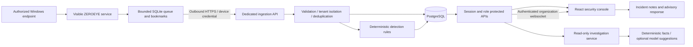

# ZEROEYE

**Detect. Investigate. Defend.**

A Windows endpoint security monitoring platform with a React operations console, an Express modular backend, PostgreSQL evidence storage, deterministic detection rules, and a read-only investigation service.

**Status: verified local development implementation; the full MVP and production release are not complete.** See [progress](docs/PROGRESS.md), [verification](docs/VERIFICATION.md), and [limitations](docs/LIMITATIONS.md). No hardcoded production statistics or genuine-incident claims based on demo records.

## Architecture



The backend is a modular monolith. Browser sessions and device credentials have separate authentication paths. The native agent needs no inbound network port. Every organization is isolated in API queries; composite foreign keys constrain device/event/alert/incident evidence relationships.

## Implemented

- Register/login/logout with salted scrypt password hashes and hashed, expiring HttpOnly cookie sessions.
- Organization creation, membership and Owner/Admin/Analyst/Viewer authorization; Origin and per-session CSRF checks.
- One-use, ten-minute enrollment tokens; device-specific hashed credentials, revocation and rotation API.
- Strict event validation, policy enforcement, database deduplication and transactional event/alert persistence.
- Eight deterministic detections with positive and false-positive tests. Privilege/time rules require explicit policy.
- Database-driven dashboard, event filtering/pagination/details, CSV/JSON export, alert evidence and authenticated WebSockets with polling fallback.
- Incident assignment, notes, evidence attachments, resolution/reopening and auditable advisory recommendations.
- FastAPI deterministic evidence summaries; opt-in Ollama suggestions with Pydantic validation. Confirmed facts are computed, not invented by a model.
- Windows event collector, atomic queue/checkpoints, DPAPI identity, bounded retry, heartbeat, privacy defaults, visible service source and built Windows executables.
- Inno Setup installer source, container/HTTPS configuration, CI, retention script, backup instructions, API specification and isolated synthetic demo generator.

## Windows quick start

Use PowerShell in `D:\project\zeroeye`. Ordinary application development does **not** require an administrator terminal. Node 24 LTS, Python 3.14, Git and the RTK wrapper are installed on the development machine used for verification. Docker and Inno Setup are optional alternatives/tools and were absent during verification.

1. Install JavaScript dependencies and generate the database client:

```powershell
rtk proxy npm.cmd ci
rtk proxy npm.cmd run db:generate
```

2. Open a separate terminal and start workspace-local PostgreSQL:

```powershell
rtk proxy npm.cmd run db:local
```

Keep this terminal open. The script creates a random database password, stores its files under ignored `.runtime/`, binds only to `127.0.0.1:54329`, and creates `.env` if it does not already exist. It never overwrites an existing environment file. If you already have PostgreSQL, copy `.env.example` to `.env` and set your own connection string instead. Never use placeholder secrets.

3. In your first terminal, apply migrations, prepare Python and start the investigation service:

```powershell
rtk proxy npm.cmd run db:migrate
rtk proxy python -m venv .runtime/python
rtk proxy .runtime/python/Scripts/python.exe -m pip install -r agents/windows/requirements-dev.lock.txt -r apps/ai-service/requirements.lock.txt
rtk proxy npm.cmd run ai:dev
```

Keep the investigation-service terminal open. It reads the same random `AI_SERVICE_TOKEN` as the API.

4. In another terminal, start the API and web console:

```powershell
rtk proxy npm.cmd run dev
```

Open **http://localhost:5173**. Use localhost consistently: browser Origin must match `WEB_ORIGIN`. Select **Create a workspace** and use a password of at least 12 characters. New organizations begin with zero devices and zero events. Stop foreground services with Ctrl+C.

For real monitoring, follow [Windows agent setup](docs/windows-agent.md). Service installation, protected Security-log access and state ACL setup require explicit administrator approval. No service was installed during this development run.

## Verification commands

With the local database and investigation service running:

```powershell
rtk proxy npm.cmd run typecheck
rtk proxy npm.cmd test
rtk proxy npm.cmd run build
rtk proxy npm.cmd run test:integration
rtk proxy .runtime/python/Scripts/python.exe -m pytest agents/windows/tests apps/ai-service -q
rtk proxy npm.cmd audit
rtk proxy npm.cmd run agent:build
rtk proxy agents/windows/dist/ZeroEye-Agent/ZeroEye-Agent.exe --help
```

Integration tests create a random test-only PostgreSQL schema, use synthetic fixtures, and remove only that schema in a finally block. They do not read real Security logs. The local public schema remains empty until you create a user or explicitly run a demo.

## Demo, security and deployment

- [Isolated demo guide](docs/demo.md)
- [Live presentation walkthrough](docs/presentation.md): `rtk proxy npm.cmd run demo:live`
- [API reference and schemas](docs/API.md), [OpenAPI JSON](docs/openapi.json)
- [Security design](docs/SECURITY.md)
- [Deployment, HTTPS and backups](docs/DEPLOYMENT.md)
- [Windows collection and packaging](docs/windows-agent.md)

External model processing is off by default. There are no built-in cloud subscriptions or API charges. If you deploy to paid hosting or configure a remote model provider, you are responsible for its resource and usage costs.

## Technology and package boundaries

| Path | Responsibility |
|---|---|
| `apps/web` | React 19, TypeScript, Vite, Tailwind, shadcn-style Radix Button, Lucide, Recharts, TanStack Query, Router, React Hook Form, Zod |
| `apps/api` | Express 5, Prisma 6, PostgreSQL, session/RBAC/CSRF boundaries, incidents, ingestion, WebSockets |
| `packages/shared-types` | Strict normalized event contracts and shared types |
| `packages/detection-rules` | Pure deterministic rules and evidence tests |
| `agents/windows` | Python/pywin32 collection, queue, service, packaging and tests |
| `apps/ai-service` | FastAPI/Pydantic baseline and optional provider abstraction |
| `scripts`, `infrastructure` | Development, migrations, test schemas, retention, Docker and HTTPS |

## Screenshots and release roadmap

Browser screenshots remain pending because this session had no connected browser surface. The dashboard has automated empty/error/login-state tests; it has not had visual browser QA.

Release gates: clean Windows installer/reboot/uninstaller tests; authorized real Security-log end-to-end tests; Docker deployment/restore verification; membership removal/role-change lifecycle; email verification/reset/delivery; richer reports and notification preferences; a reviewed tenant/agent retention policy and operational security review. Statistical anomaly models, Sigma import and automatic containment are not implemented. See the progress checklist for exact status.
